# AIDAqc v2.2 phantom workflow manual

Atlas-based Imaging Data Analysis pipeline for Quality Control of Animal MRI Data

**Code:** Aref Kalantari, Mehrab Shahbazi, Marc Schneider, Markus Aswendt<br>
**Manual:** Aref Kalantari, Markus Aswendt<br>
**August 2026**<br>
Department of Neurology, University Hospital Frankfurt

*Converted from the [original PDF manual](AIDAqc_open_dev.pdf) bundled with the `phantom` branch. The filename retains its former `open-dev` name. Figure numbering and instructions are retained; contact information has been updated.*

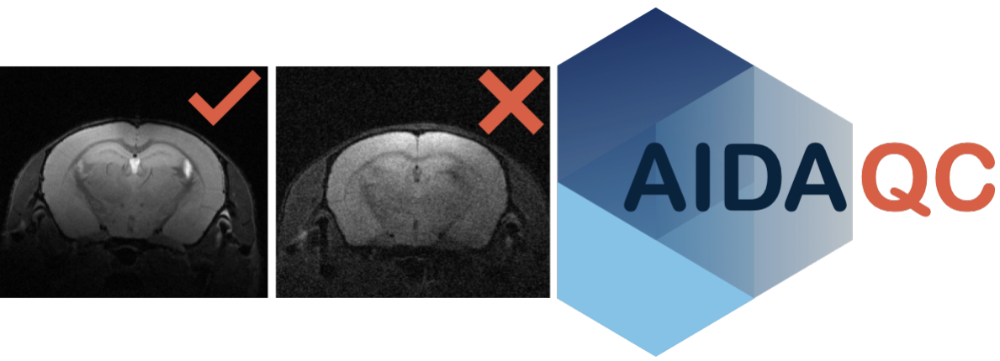

## Contents

- [1. Introduction](#introduction)
- [2. Installation](#installation)
- [3. Scripts](#scripts)
- [4. Workflow](#workflow)
- [5. FAQ](#faq)

<a id="introduction"></a>

## Introduction

It can be challenging to acquire MR images of consistent quality or to decide in the screening of large, longitudinal datasets, which data is of sufficient quality for further processing. Manual screening without quantitative criteria is strictly user-dependent and not feasible at large scale. In contrast to clinical MRI, in the preclinical setting, there is no consensus on standardization of QC measures or categorization of good vs. bad quality images.

The Atlas-based Processing Pipeline for Quality Control of Animal MRI Data (AIDAqc) was developed for measuring and standardizing the quality of mouse brain MRI in a dynamic and novel way. It was later adapted to work with mouse and rat phantoms as well. AIDAqc is applicable with T2-weighted MRI (T2w), diffusion-weighted MRI or diffusion tensor imaging (DTI), and functional MRI (fMRI).

AIDAqc was developed in Python to create with the aim to automate the calculation of QC measures, and provide a machine learning-assisted rating of good and bad quality images. Quality measures include: SNR, temporal SNR (tSNR), spatial resolution, ghosting, and movement ([Figure 1](#figure-1)). Currently, this tool covers T2w, DWI, and fMRI sequences.

### I) Parsing

The user sets the input path and the program will parse iteratively through all subfolders with a list of all raw MR data or nifti data as its result. After parsing, only those MR files chosen by the user between the options of T2w, DTI, or fMRI data are selected, and duplicates are eliminated. Finally, CSV files are created with the storage path of every selected file, which will be the input of the next step.

### II) Feature calculation

In this step, sequence-specific quality features are calculated. Signal-to-noise ratio (SNR) is determined for T2-weighted (T2w) and diffusion-weighted (DWI/DTI) images, while temporal SNR (tSNR) is calculated for functional MRI (fMRI). Motion variability is quantified for compatible 4D DWI/DTI and fMRI data using the standard deviation of mutual information (MI) values between image volumes. Ghosting is assessed for all supported modalities and is additionally quantified using a continuous intensity-based ghost-to-signal ratio (GSR). Spatial resolution, slice thickness, and other image properties are extracted and stored together with the calculated QC features for subsequent outlier detection.

### III) Outlier detection

In this step, all of the calculated features will be statistically analyzed with the help of five methods to identify outliers: One class SVM, Isolation Forest, Local Outlier Factor, and Elliptic Envelope. In addition to these, a normal statistical definition of outliers based on the interquartile range is also used.

<a id="figure-1"></a>

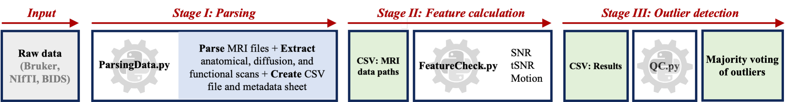

**Figure 1:** Pipeline workflow: All of the necessary functions are implemented in this module, SNR is calculated by using the [Chang method](https://www.spiedigitallibrary.org/conference-proceedings-of-spie/5747/0000/An-automatic-method-for-estimating-noise-induced-signal-variance-in/10.1117/12.596008.short?SSO=1) and also the more popular way with the help of defining regions of interest inside and outside of the brain (I) In this stage, all of the available MR files are parsed and located. (II) In the main block, here all of the parameters are calculated: SNR, tSNR, and Motion artifacts. Spatial Resolution, slice thickness, and the number of repetitions are also extracted. The final output is CSV files located in a folder called “calculated features”. (III) Five different outlier detectors, each with their own strengths and weaknesses will determine together as a ”major vote” what image is considered a bad quality image.

<a id="installation"></a>

## Installation

There are various options of how to get the pipeline running. The following way using an anaconda environment is the most compatible one across different OS systems. However if you are familiar with python based piplines, other ways are also possible.

1. Download or clone the repository by using this [link](https://github.com/Aswendt-Lab/AIDAqc). The project folder contains the Python scripts necessary for quality measurement.

2. Download & Install Python 3.6 or higher using [Anaconda](https://www.anaconda.com/distribution/).

3. <a id="importing-the-environment"></a>Importing AIDAqc environment: After the installation of the anaconda navigator, we have to import the necessary environment. This can be done by importing the ”aidaqc.yaml” file at the Environments tab, import and choosing local drive if the file is downloaded from GitHub to a local drive. Make sure to choose the correct .yaml file: aidaqc-arm64.yaml (Apple Silicon), aidaqc-intel.yaml (legacy Intel environment)

<a id="figure-2"></a>

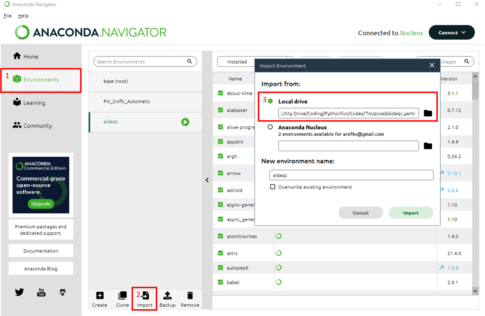

**Figure 2:** Importing the environment downloaded from GitHub: Environments/Import/Local drive .

You can also directly use the Anaconda terminal and type in the following commands:

```bash
cd aidaqc
conda env create --name aidaqc --file=aidaqc.yml
```

An alternative approach is to create a new environment (for example aidamri) with anaconda terminal and then to run the requirements.txt in the environment.

```bash
conda create -n aidaqc
conda activate aidaqc
pip install -r PATH/AIDAqc/requirements.txt
```

<a id="scripts"></a>

## Scripts

List of important Scripts:

- ParsingData.py: This is the main and only script for the user. Parser for identifying the location of T2w, DTI, and fMRI files based on their sequence name. By using python ParsingData.py -h a short explanation and a list of available options will appear. An initial path can be set by the user, the program will use this path as a starting point and search for MR files in every possible subsequent folder after this initial path. The second input is a saving path which is the location where the results should be saved. Figure [7](#figure-7) shows an exemplary use of the author.

- FeatureCheck.py: After ParsingData.py has been used. CSV files with the corresponding addresses are created at the defined location given by the user. These CSV files are used as input for this function. But be aware that this will happen automatically from the ParsingData.py script this explanation is just for the sake of clarification.

- QC.py: Contains the QC metric, outlier-detection, visualization, and report-generation functions used throughout the pipeline. After completion of Stage III, the script automatically generates the final votings.csv table and a standardized AIDAqcQAReport.pdf (see [8](#figure-8)).

<a id="figure-3"></a>

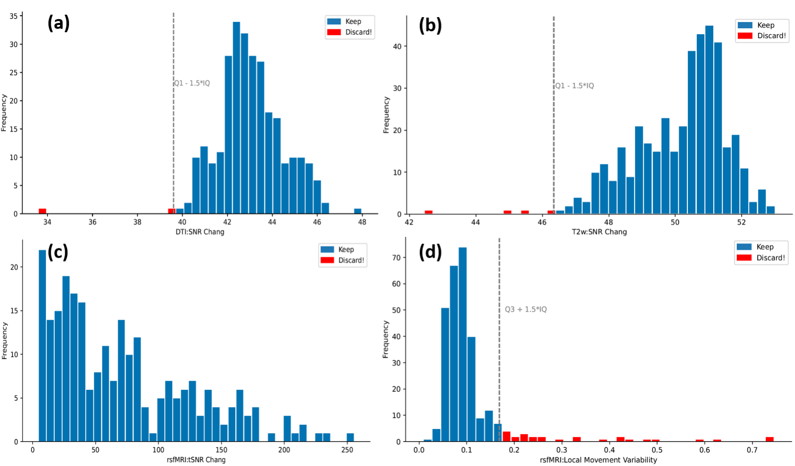

**Figure 3:** Exemplary statistical plots. The grey vertical line indicates the threshold of good vs bad data based on the statistical definition of ”outliers”. The bars with the red color indicate those files which should be discarded. (a) Histogram of SNR values of the DTI dataset (b) Histogram of SNR values of the T2w dataset (c) Histogram of tSNR values of the rsfMRI dataset (d) Histogram of the movement variability of the rsfMRI dataset, calculated based on mutual information

Attention: All program examples are only listed with the mandatory input parameters. For more details/help, call `python .../python <command> -h`. After a successful download and installation of the necessary libraries, you can start using the pipeline.

<a id="workflow"></a>

## Workflow

Here we want to show how the pipeline can be used. The steps are explained subsequently.

1\) Download the sample data set from GIN via this [link](https://gin.g-node.org/arefks/AIDAqc_test_data).

2\) Download the repository from this [link](https://github.com/Aswendt-Lab/AIDAqc) and follow the installation steps described in the Installation chapter.

3\) Open a terminal and by using the cd command go to the directory where the repository is located. You can copy and paste the following code into the terminal and replace it with the necessary address (figure [4](#figure-4)).

```bash
cd <!!YOURPATH!!>/Quality Control-main/
```

<a id="figure-4"></a>

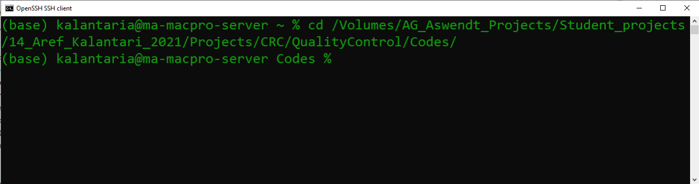

**Figure 4:** Changing the terminal’s directory to the folder containing the Python scripts downloaded from GitHub.

4\) activate the aidaqc environment by typing in the following command (figure [5](#figure-5)).

```bash
conda activate aidaqc
```

<a id="figure-5"></a>

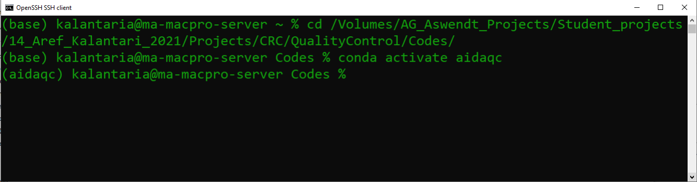

**Figure 5:** Activating the aidaqc environment. Note that the installation of anaconda and loading the .yaml file is a prerequisite for this step to work (see [3](#importing-the-environment)).

5\) Check if the environment has been installed correctly. This can be done by using the help option of the function by using the following command. Additionally, a short explanation can also be seen.

```bash
python ParsingData.py -h
```

<a id="figure-6"></a>

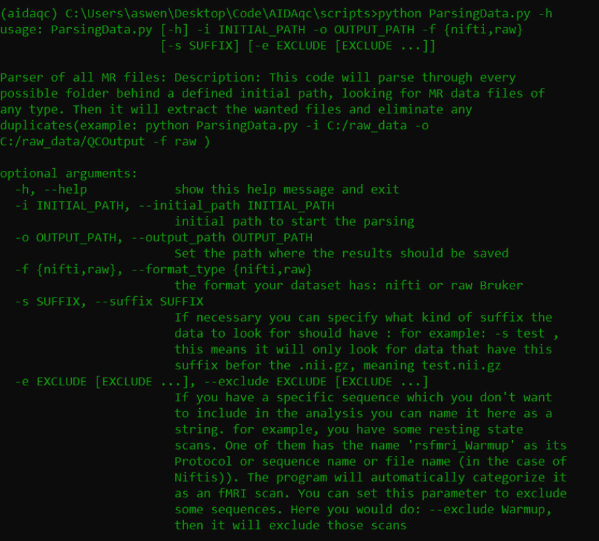

**Figure 6:** Using ParsingData.py with the help option.

6\) After activating the environment the process can be started by typing in the following command using the script ParsingData.py.

```bash
python ParsingData.py -i Inpath -o outpath -f nifti -s .1 -e noise copy raw
```

7\) After the program has parsed the files and calculated the QC features, one csv file for each available sequence will be created. The curent stage can be seen in the terminal output.

<a id="figure-7"></a>

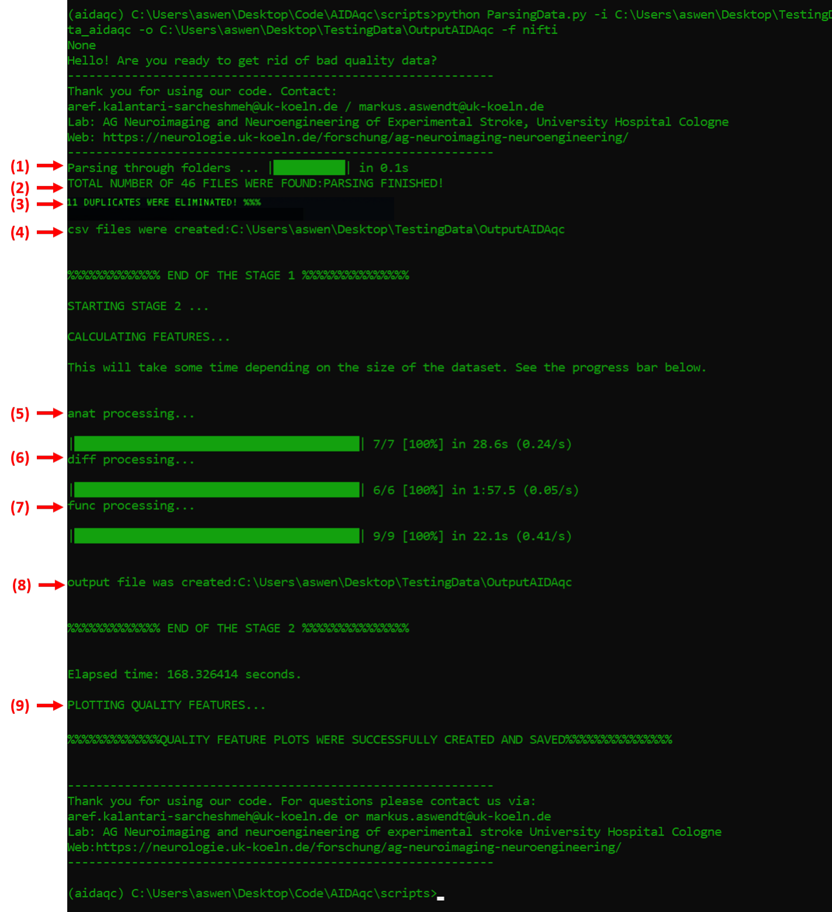

**Figure 7:** Structural overview and summary of the pipeline. 1) Searching for all MR files available 2) Extracting the sequences related to T2w, DTI, and fMRI measurements from the parsed files 3) Duplicate MR files will be only considered once and any file address of copies are eliminated. 4) Final CSV files of stage (I) containing all addresses are created at the defined location. 5) In this part all of the file addresses of part 4 are processed sequence-based. 6) Some files which can contain faulty data or faulty structures with incomplete data won’t cause any problems and will also be saved as an Error data tab in the corresponding CSV file. 7) Same as in 6 faulty fMRI data will be filtered out. 8) Final CSV file in stage (II) containing all of the calculated QC features is saved in this stage. 9) Finally, statistical plots are created and the final results of bad quality data are saved in votings.csv

8a) Now, it is possible to check the votings.csv file to review the results of the five outlier-detection methods for each identified outlier (see [Fig. 8](#figure-8)). A file is included in votings.csv if it has been flagged by at least one of the five methods. The total number of votes therefore ranges from 1 to 5 and indicates how consistently a scan is identified as an outlier relative to the other scans in the dataset. Files receiving four or five votes warrant particular attention, whereas one or two votes may indicate more subtle deviations from the overall distribution. The interpretation of the number of votes depends on the composition and homogeneity of the analyzed dataset and should not be regarded as a fixed exclusion criterion. For convenient inspection and sorting, the votings.csv file can be opened in spreadsheet software and filtered according to sequence type, individual outlier-detection methods, or the total number of votes. The final decision to retain or exclude an image remains with the user and should consider the quantitative QC results, visual inspection of the corresponding image, and the requirements of the respective research question. After completion of Stage III, AIDAqc additionally generates the AIDAqcQAReport.pdf. This report provides a standardized summary of the quality assessment, including dataset and modality information, calculated QC features, continuous motion and ghosting measures where applicable, results of the individual outlier-detection methods, the total number of votes, and available QC visualizations. The PDF report does not introduce an additional exclusion criterion but summarizes the results of the AIDAqc analysis to facilitate transparent documentation and subsequent quality assessment.

<a id="figure-8"></a>

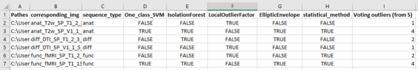

**Figure 8:** Exemplary snapshot of the voting.csv output results. Column A contains the direct path to the NIfTI file or the raw Bruker sequence. Column B is the name of a snapshot saved for quick inspection in the manual slice inspection folder. Column C refers to the sequence type. Columns E to H refer to the different outlier algorithms’ outputs, with TRUE indicating flagging the file as an outlier and FALSE indicating no outlier. Column I shows the sum of the votes from the outlier algorithms.

8b) Also available in the outputs of AIDAqc are, of course, the individual feature calculations in the calculated features folder, separated into multiple CSV files based on the sequence. In [Fig. 9](#figure-9), you can see a stitched example of all three available sequence types. For each sequence, there is a column similar to the voting.csv containing the corresponding path to the image file, the sequence type (which should be the same for each CSV file), resolution information in the x, y, and z coordinates of the image, and the corresponding features for each sequence.

<a id="figure-9"></a>

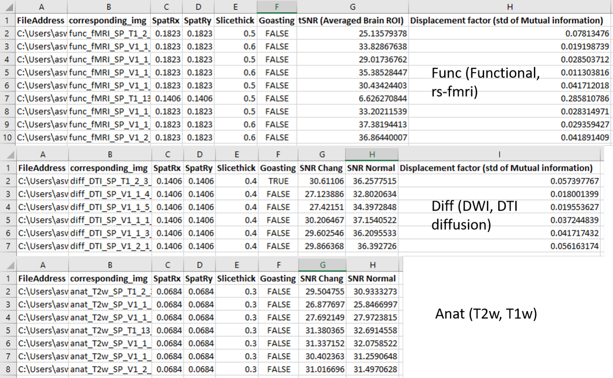

**Figure 9:** Exemplary snapshot of the calculated features folder in the output results of AIDAqc.

8c) Lastly, as mentioned before, a folder is created called manual slice inspection, which contains snapshots of all the subjects parsed by using the pipeline on the corresponding project. This is solely for the purpose of quick screening of the data by the user. As these snapshots are produced live while the pipeline is running, it can also be very useful to see if the desired images are processed and not some other post-processed files. If this is not the case, the user can stop the process and adjust any necessary exclusions or suffix requirements when using ParsingData.py.

<a id="figure-10"></a>


**Figure 10:** Exemplary snapshot of the manual slice inspection folder in the output results of AIDAqc.

### 8d) AIDAqc QA report

After completion of Stage III (outlier detection), AIDAqc automatically generates a standardized QA report (AIDAqcQAReport.pdf). The report summarizes the results generated during the preceding stages of the pipeline and provides a single document that can be archived together with the analyzed dataset as a quality-assurance (QA) protocol.

The report includes information about the analyzed dataset and available MRI modalities, the calculated QC features, the results of the five Stage III outlier-detection methods, the number of methods identifying individual scans as outliers, and the available QC visualizations. Where applicable, the additional quantitative motion and ghosting measures are also included.

For traceability and reproducibility, the report additionally records information about the AIDAqc analysis and the result files used to generate the report.

The PDF is generated only after Stage III has been completed and votings.csv has been written. Report generation therefore does not modify the preceding feature calculations or outlier-detection results.

<a id="faq"></a>

## FAQ

### Q1) How is the SNR of the T2w and DTI sequences calculated?

The SNR is calculated based on two methods, first one is based on [chang method](https://www.spiedigitallibrary.org/conference-proceedings-of-spie/5747/0000/An-automatic-method-for-estimating-noise-induced-signal-variance-in/10.1117/12.596008.short?SSO=1). Simply said this method calculated the SNR without needing to define regions in the image. The second one uses the standard way of calculating SNR namely defining regions of interest inside and outside of the brain. As for this pipeline, the input T2w dataset usually consists of more the one slice of the brain. For example, we have an image set with a dimension of 128 × 128 × 20, the pipeline extracts the 5 best subsequent slices with the highest average value indicating a good image of the brain. Usually, the best slices are the middle ones. If the first or the last slices are the highest slices a warning like in figure [11](#figure-11) will be shown in the terminal and this can indicate a faulty dataset. The reason for this happening can be two things, either the dataset has just one slice which makes no problem and the error can be ignored or the dataset has more slices and it was a faulty measurement where the position of the slice was selected wrongly.

<a id="figure-11"></a>

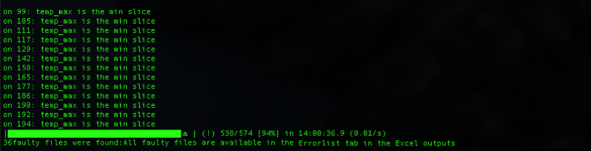

**Figure 11:** Warning for a dataset in which the first or the last slices have the most signal.

### Q2) How is the tSNR calculated?

To calculate the temporal signal-to-noise ratio multiple approaches are available in the literature, most of them are using normal SNR measurements but add some calculation steps to make it legitimate to be called tSNR. Let’s assume a simple example again to understand how it is calculated in this pipeline. Consider an fMRI dataset with dimensions of 128×128×20×500 with 20 being the slices and 500 being the temporal time points. Similar to the T2w approach, the 4 best subsequent slices are chosen based on average image intensity. After this step, SNR is calculated based on this [tSNR method](https://www.sciencedirect.com/science/article/pii/S105381190600992X). Simply said the tSNR is calculated for each voxel over time, and then it is averaged for a region in the brain. AIDAqc first identifies the image region containing the brain automatically. The image is thresholded and the intensity-weighted center of mass is determined. A three-dimensional spherical ROI is then positioned around this center. The radius of the ROI is determined automatically from the image dimensions. The voxel-wise tSNR is calculated within this automatically positioned brain ROI. The individual voxel values within the ROI are subsequently averaged to obtain a single representative tSNR value for the acquisition. This automatic ROI placement avoids manual selection of a brain region and applies the same procedure consistently across all fMRI datasets..

$$
\mathrm{tSNR} = \frac{\mu}{\sigma} = \frac{\mu}{\sqrt{\frac{1}{N}\sum_{i=1}^{N}(x_i-\mu)^2}}
$$

This is done for all voxels of the defined volume, grown from the center of mass. The final tSNR is the average value of those.

### Q3) How is the MI-based motion variability calculated?

Mutual information (MI) was used to calculate movement in the resting state MR measurements. Check out [Mutual information as an image matching metric](https://matthew-brett.github.io/teaching/mutual_information.html) to better understand the concept of Mutual information in image analysis. To explain how MI was used in this pipeline, it’s easier to use our example dataset with a dimension of 128 × 128 × 20 × 500. The question is how much movement has happened between the image at T = t and T = t + 1. The four best slices are chosen based on the approach already explained in Q1 and Q2. The image of the first time point is then used as the reference image and all of the following 499 images are compared to the first one by calculating the MI between them. If the MI is high, it means the movement was small. If it’s low then the movement was relatively big. The standard deviation of all the MI values is then used as a metric for the overall movement severity. So the final output observable in the CSV file are standard deviation values.

### Q4) How is ghosting calculated and how is it different from motion?

Ghosting and motion are different image-quality problems and are quantified separately in AIDAqc. Motion describes changes between volumes in a 4D acquisition, whereas ghosting describes spatially displaced replicas of the image.

For compatible 4D DWI/DTI and fMRI data, AIDAqc quantifies motion using mutual information (MI). After removal of the initial volumes, the first retained volume is used as a reference and MI is calculated between the reference and subsequent volumes. The standard deviation of these MI values is used as a measure of motion variability:

$$
\mathrm{Motion} = \operatorname{SD}(\mathrm{MI}_1,\mathrm{MI}_2,\ldots,\mathrm{MI}_n)
$$

Higher values indicate greater variability between volumes. This measure represents MI-based motion variability and not physical displacement in millimetres. No corresponding temporal motion value is calculated for anatomical MRI.

Ghosting is quantified independently using a continuous ghost-to-signal ratio (GSR). For 4D data, a mean image across volumes is first generated. A foreground or object mask is automatically defined using an intensity threshold based on the 70th percentile of positive voxel intensities. The expected ghost region is then approximated by shifting this mask by half of the field of view (FOV/2) along the phase-encoding image axis. Regions overlapping with the original object are excluded, and the background intensity is estimated outside the original object mask.

The GSR is calculated as:

$$
\mathrm{GSR} = \frac{\operatorname{mean}\left(\left|I_{\mathrm{ghost}}-\operatorname{median}(I_{\mathrm{background}})\right|\right)}{\operatorname{mean}(I_{\mathrm{object}})+\epsilon}
$$

where Ighost represents intensities within the expected ghost region, Ibackground represents background intensities, Iobject represents the signal within the original image object, and ϵ prevents division by zero. Higher GSR values indicate stronger ghost-related signal contamination.

The main difference is therefore that motion measures temporal variability between image volumes, whereas GSR measures spatial signal contamination at an expected ghost location. Consequently, an acquisition can exhibit low motion but substantial ghosting, or substantial motion without pronounced ghosting. The two measures should therefore be considered complementary QC metrics. The continuous GSR is provided as an additional quantitative measure and does not introduce a fixed exclusion threshold.

### Q5) How does the parsing work in detail?

The parsing technique of this pipeline can be difficult to understand. With the help of figure [12](#figure-12) it gets clearer how the parsing works.

<a id="figure-12"></a>


**Figure 12:** In this illustration, three scenarios can be seen. In each scenario the initial path as used in figure [6](#figure-6) is set to different folders. The colored arrows are the exact way how the pipeline searches the folders for MR files.

### Q6) Can the pipeline process other sequences as well?

For now, the pipeline can only parse T2w, DTI, and fMRI sequences. This is done by using the sequence types extracted from the header information of each measurement. In this pipeline, they are defined as: `['Dti*', 'EPI', 'RARE']` which are only related to the sequence type used for the measurement and the names are predefined default names of Bruker’s ParaVision Software. So it might be possible that other kinds of measurements use these sequences as well but are not compatible to be used with this pipeline[^1]. Another problem that might accrue is that if one of the permitted sequences (T2w, DTI, fMRI) is measured with multiple echo times, repetition times, separate receiver channels, repetitions for averaging purposes, or any kind of additional dimension except Slices, Time and Diffusion directions, the pipeline will not work. It is planned for the near future to add more features.

### Q7) How are the SNR of the T2w and DTI sequences calculated?

AIDAqc calculates the signal-to-noise ratio (SNR) of T2-weighted (T2w) and diffusion-weighted (DWI/DTI) images using two complementary methods: Chang SNR and a conventional ROI-based SNR.

Chang SNR The first method uses the Chang noise-estimation approach and does not require explicit placement of signal and background ROIs. For images containing more than four slices, AIDAqc evaluates four central slices around the middle of the acquired volume. For DWI/DTI data, the calculation is repeated across a subset of the available diffusion volumes. The resulting slice- and volume-specific SNR estimates are averaged to obtain the final SNR Chang value.

The SNR is expressed in decibels (dB):

$$
\mathrm{SNR}_{\mathrm{Chang}} = 20\log_{10}\left(\frac{\mu_{\mathrm{image}}}{\sigma_{\mathrm{Chang}}}\right)
$$

where µimage is the mean image intensity and σChang is the noise estimate obtained using the Chang method.

ROI-based SNR The second method automatically defines separate regions for estimating brain signal and background noise. For 4D datasets, the first volume is used for this calculation. First, AIDAqc determines the intensity-weighted center of mass of the complete 3D image. A spherical signal ROI is then centered at this position. The radius of the sphere is defined as approximately 10 percent of the mean image dimension, with its size restricted when necessary by the number of acquired slices.

The mean intensity within this spherical ROI is used as the signal estimate:

$$
S = \operatorname{mean}(I_{\mathrm{signal\ ROI}})
$$

Background noise is estimated independently from the signal ROI. AIDAqc defines eight three-dimensional corner regions, corresponding to all combinations of the upper and lower image boundaries in the x, y, and z directions. Each corner region extends approximately 15 percent of the image dimension along each axis. This placement is designed to sample background regions surrounding the brain while minimizing contamination from brain signal.

The voxel intensities from all eight corner regions are pooled, and the standard deviation across the pooled background voxels is used as the noise estimate. The standard deviation across the voxel intensities contained in these eight corner regions is used as the noise estimate:

$$
N = \operatorname{SD}(I_{\mathrm{8\ background\ regions}})
$$

The final ROI-based SNR, reported as SNR Normal, is calculated in decibels as:

$$
\mathrm{SNR}_{\mathrm{Normal}} = 20\log_{10}\left(\frac{S}{N}\right)
$$

Thus, the signal and noise regions are positioned automatically and consistently for every image, avoiding manual ROI placement. The central spherical ROI provides a representative estimate of brain signal, whereas the eight peripheral corner regions provide an estimate of background noise.

If the background contains only zeros, for example after previous brain extraction or masking, the noise standard deviation can become zero and the calculated SNR would be infinite. In this case, AIDAqc replaces the resulting infinite value with NaN and reports a warning because the ROI-based SNR cannot be reliably determined from such an image.

### Q) Why is the pipeline divided into separate stages?

The reason behind this is to increase the stability of the program and to prevent the need to run the pipeline multiple times from the beginning. As explained above, separate CSV tables are created in each stage. Stage (I) is relatively fast and it won’t cause any long waiting periods to rerun that part if necessary. Stage(II) on the other hand can take more time, sometimes up to hours to finish, therefore it is possible that if an error accrues in the plotting part of the code, to simply correct the error and read the CSV file created from the second stage and to do the plotting without the need to wait again for the whole pipeline to run again from the beginning.

### Q10) What is meant by the warning: Some faulty files were found: All faulty files are available in the Errorlist?

With this warning, the pipeline just informs the user that some key files of the main image file could not be read. These can be one of the method, viso parameters, ... files from the Bruker sequence folder. However, all these files are also listed and saved in a separate csv file in the output folder.

### Q9) After running the pipeline, where can I find the data which should be excluded?

In the final CSV sheet named voting.csv are all of the data listed which had at least one vote from the machine-learning outlier detectors (”Judges”). If all five outlier detectors have voted the Image as an outlier, it can be said with a high possibility that it is really bad. And usually based on experience the images with all five detectors voting for a bad/outlier image are pure noise images or extreme Ghosting artifacts.

### Q10) When running the help option of the function ParsingData.py, there are other options as well, can you elaborate more about them?

The -i and -o are self-explanatory. -f can be used if it should check raw Bruker data or Nifti data. Be aware that the tool is more stable for only Nifti data. The reading process of raw data can vary a lot between datasets and is not guaranteed to function for any kind of raw dataset. -s is a useful flag and it will be only used for processing Nifti data. Imagine you have your main T2.nii.gz file which you want to process with this tool. Also because of some other processing you already have done, there are lots of irrelevant nii files available that you don’t want to include in the quality assessment for example T2.mask.nii, T2.proccesed.nii, T2Mask.seperated.nii, etc. It might even be the reason for ”the error” while using the tool. By using the -s flag you can set it as -s T2, and the tool will only look/parse for files ending with `*T2.nii`.

## Author

I have designed this pipeline to help me validate all the MR data that I use for further processing in my project. I was searching for a kind of standardization to dichotomize MR data into good and bad data. Over time I found out that this can’t be done as easily as thought. The key point of this standardization tool is that one realizes good and bad can not be set with fixed global values of any kind of features like the SNR and as everything in life is, it should be looked at relatively.

## Contact

Please report bugs and technical issues directly in [GitHub Issues](https://github.com/Aswendt-Lab/AIDAqc/issues) and specify that you are using `phantom`.

For all other requests, email [aswendtlab@gmail.com](mailto:aswendtlab@gmail.com).

The end

<a id="sequence-note"></a>

[^1]: For example Arterial Spin Labeling (ASL) sequences, DCE and DSC sequences, etc.
