# AIDAqc v2.1 manual

Atlas-based Imaging Data Analysis pipeline for Quality Control of Animal MRI Data

**Code:** Aref Kalantari, Mehrab Shahbazi, Marc Schneider, Markus Aswendt  
**Manual:** Aref Kalantari  
**April 2023**  
Department of Neurology, University Hospital Cologne

*Converted from the [original PDF manual](AIDAqc_v2_1.pdf). Figure numbering and the original instructions are retained; contact information has been updated.*

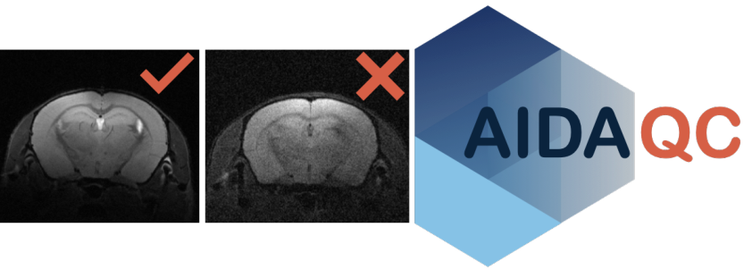

## Contents

- [1. Introduction](#introduction)
- [2. Installation](#installation)
- [3. Scripts](#scripts)
- [4. Workflow](#workflow)
- [5. FAQ](#faq)

<a id="introduction"></a>

## Introduction

It can be challenging to acquire MR images of consistent quality or to decide in the screening of large databases, which dataset is of sufficient quality for further processing. Manual screening without quantitative criteria is strictly user-dependent and not feasible for huge databases. In contrast to clinical MRI, in preclinical, animal imaging, there is no consensus on standardization of quality control measures or categorization of good vs. bad quality images.

The Atlas-based Processing Pipeline for Quality Control of Animal MRI Data (AIDAqc) was developed for measuring and standardizing the quality of mouse brain MRI in a dynamic and novel way. AIDAqc works with T2-weighted MRI (T2w), diffusion-weighted MRI or diffusion tensor imaging (DTI), and functional MRI (fMRI).

Here, we developed a tool in Python to create a basic overview of MR image datasets including information about the SNR, temporal SNR (tSNR), spatial resolution, and movement severity ([Figure 1](#figure-1)). Currently, this tool covers T2w, DWI, and fMRI sequences.

### I) Parsing

The user sets the input path and the program will parse iteratively through all subfolders with a list of all raw MR data or nifti data as its result. After parsing, only those MR files chosen by the user between the options of T2w, DTI, or fMRI data are selected, and duplicates are eliminated. Finally, CSV files are created with the storage path of every selected file, which will be the input of the next step.

### II) Feature calculation

In this step, SNR is calculated for T2w and DTI images, tSNR, and movement severity for fMRI images. Mutual information was used as a metric to calculate movement severity.

### III) Outlier detection

In this step, all of the calculated features will be statistically analyzed with the help of five methods to identify outliers: One class SVM, Isolation Forest, Local Outlier Factor, and Elliptic Envelope. In addition to these, a normal statistical definition of outliers based on the interquartile range is also used.

#### Sample size considerations
> **For exploratory analyses, we suggest using at least 30 comparable scans per sequence type as a practical rule of thumb.
> This threshold has not been validated and does not guarantee reliable outlier detection.
> With fewer than 30 scans per sequence type, use the combined ML voting only as supplementary guidance alongside manual quality control.
> Regardless of sample size, outlier votes should not be the sole basis for excluding scans. See the table below for method-specific considerations.**

Sample counts refer to complete rows remaining in each feature CSV after rows with missing values have been removed. Anatomical, diffusion, and functional scans are evaluated separately. Individual slices and time points do not count as separate training samples.

| Method | Sample-size considerations |
|---|---|
| [Local Outlier Factor](https://scikit-learn.org/stable/modules/generated/sklearn.neighbors.LocalOutlierFactor.html) | The current configuration uses 20 neighbors, requiring at least 21 scans to retain that neighborhood size. With only 21 scans, each neighborhood includes all other scans. |
| [Elliptic Envelope](https://scikit-learn.org/stable/modules/generated/sklearn.covariance.EllipticEnvelope.html) | scikit-learn recommends `n_samples > n_features²`. With the default feature tables, this corresponds to at least 10 scans for anatomical and functional data (3 features), or 17 scans for diffusion data (4 features). Meeting this condition alone does not ensure reliable detection. |
| Isolation Forest | No generally applicable minimum sample size can be specified; reliability depends on the dataset and model settings. |
| One-Class SVM | No generally applicable minimum sample size can be specified; reliability depends on the dataset and model settings. |

<a id="figure-1"></a>

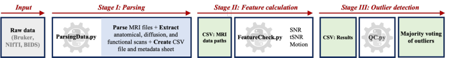

**Figure 1:** Pipeline workflow: All of the necessary functions are implemented in this module, SNR is calculated by using the [Chang method](https://www.spiedigitallibrary.org/conference-proceedings-of-spie/5747/0000/An-automatic-method-for-estimating-noise-induced-signal-variance-in/10.1117/12.596008.short?SSO=1) and also the more popular way with the help of defining regions of interest inside and outside of the brain (I) In this stage, all of the available MR files are parsed and located. (II) In the main block, here all of the parameters are calculated: SNR, tSNR, and Motion artifacts. Spatial Resolution, slice thickness, and the number of repetitions are also extracted. The final output is CSV files located in a folder called “calculated features”. (III) Five different outlier detectors, each with their own strengths and weaknesses will determine together as a ”major vote” what image is considered a bad quality image.

<a id="installation"></a>

## Installation

There are various options of how to get the pipeline running. The following way using an anaconda environment is the most compatible one across different OS systems. However if you are familiar with python based piplines, other ways are also possible.

1. Download or clone the repository by using this [link](https://github.com/Aswendt-Lab/AIDAqc). The project folder contains the Python scripts necessary for quality measurement.

2. Download & Install Python 3.6 or higher using [Anaconda](https://www.anaconda.com/distribution/).

3. <a id="importing-the-environment"></a>Importing AIDAqc environment: After the installation of the anaconda navigator, we have to import the necessary environment. This can be done by importing the ”aidaqc.yaml” file at the Environments tab, import and choosing local drive if the file is downloaded from GitHub to a local drive.

<a id="figure-2"></a>

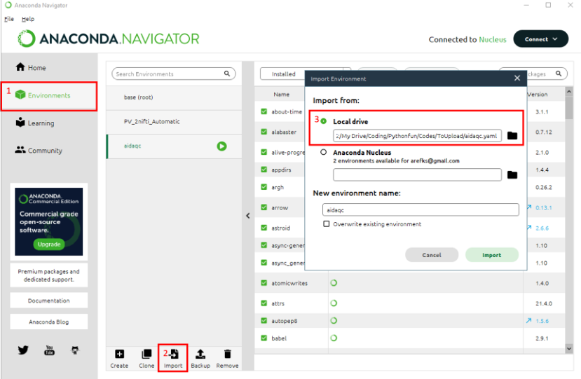

**Figure 2:** Importing the environment downloaded from GitHub: Environments/Import/Local drive .

You can also directly use the Anaconda terminal and type in the following commands:

```bash
cd aidaqc
conda env create --name aidaqc --file=aidaqc.yaml
```

An alternative approach is to create a new environment (for example aidamri) with anaconda terminal and then to run the requirements.txt in the environment.

```bash
conda create -n aidaqc
conda activate aidaqc
pip install -r PATH/AIDAqc/requirements.txt
```

<a id="scripts"></a>

## Scripts

List of important Scripts:

- ParsingData.py: This is the main and only script for the user. Parser for identifying the location of T2w, DTI, and fMRI files based on their sequence name. By using python ParsingData.py -h a short explanation and a list of available options will appear. An initial path can be set by the user, the program will use this path as a starting point and search for MR files in every possible subsequent folder after this initial path. The second input is a saving path which is the location where the results should be saved. Figure [7](#figure-7) shows an exemplary use of the author.

- FeatureCheck.py: After ParsingData.py has been used. CSV files with the corresponding addresses are created at the defined location given by the user. These CSV files are used as input for this function. But be aware that this will happen automatically from the ParsingData.py script this explanation is just for the sake of clarification.

- QC.py: In this script, all the necessary functions are gathered together which are used for most parts of the other scripts. QC.py can be seen as the toolbox of the whole pipeline (see [8](#figure-8)).

<a id="figure-3"></a>

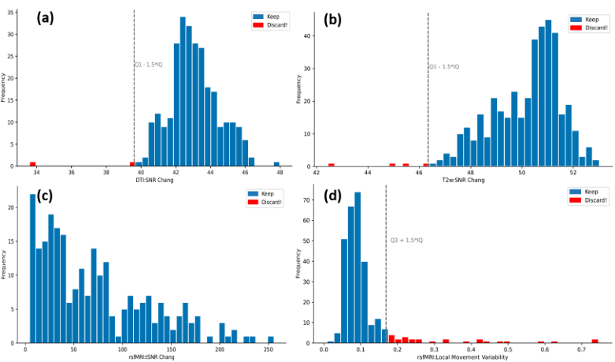

**Figure 3:** Exemplary statistical plots. The grey vertical line indicates the threshold of good vs bad data based on the statistical definition of ”outliers”. The bars with the red color indicate those files which should be discarded. (a) Histogram of SNR values of the DTI dataset (b) Histogram of SNR values of the T2w dataset (c) Histogram of tSNR values of the rsfMRI dataset (d) Histogram of the movement variability of the rsfMRI dataset, calculated based on mutual information

Attention: All program examples are only listed with the mandatory input parameters. For more details/help, call `python .../python <command> -h`. After a successful download and installation of the necessary libraries, you can start using the pipeline.

<a id="workflow"></a>

## Workflow

Here we want to show how the pipeline can be used. The steps are explained subsequently.

1\) Download the sample data set from GIN via this [link](https://gin.g-node.org/arefks/AIDAqc_test_data).

2\) If not already done, download the repository from this [link](https://github.com/arefks/Quality_Control.git) and follow the installation steps described in the Installation chapter.

<a id="figure-4"></a>

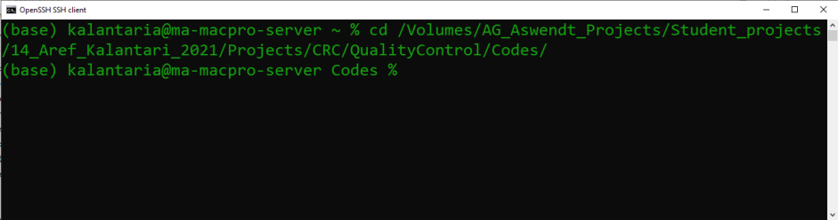

**Figure 4:** Changing the terminal’s directory to the folder containing the Python scripts downloaded from GitHub.

4\) activate the aidaqc environment by typing in the following command (figure [5](#figure-5)).

```bash
conda activate aidaqc
```

<a id="figure-5"></a>

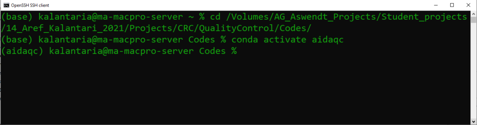

**Figure 5:** Activating the aidaqc environment. Note that the installation of anaconda and loading the .yaml file is a prerequisite for this step to work (see [3](#importing-the-environment)).

5\) After activating the environment it is best to check if the environment has been installed correctly and to see if there are any errors accruing in the script. This can be done by using the help option of the function by using the following command. Additionally, a short explanation can also be seen.

```bash
python ParsingData.py -h
```

<a id="figure-6"></a>


**Figure 6:** Using ParsingData.py with the help option.

6\) After activating the environment the process can be started by typing in the following command using the script ParsingData.py.

```bash
python ParsingData.py -i Inpath -o outpath -f nifti -s .1 -e noise copy raw
```

7\) After the program has parsed the files and calculated the QC features, one csv file for each available sequence will be created at the defined location set by the user. As can be seen in figure [7](#figure-7) the pipeline informs the user at what stage the pipeline is and how long the processing will approximately take.

<a id="figure-7"></a>

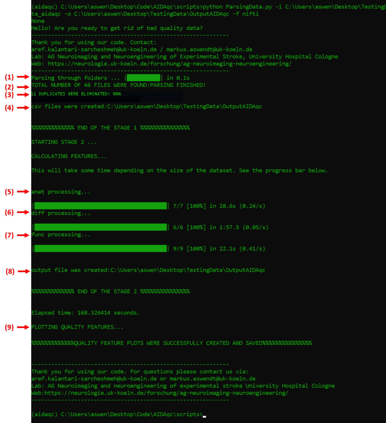

**Figure 7:** Structural overview and summary of the pipeline. 1) Searching for all MR files available 2) Extracting the sequences related to T2w, DTI, and fMRI measurements from the parsed files 3) Duplicate MR files will be only considered once and any file address of copies are eliminated. 4) Final CSV files of stage (I) containing all addresses are created at the defined location. 5) In this part all of the file addresses of part 4 are processed sequence-based. 6) Some files which can contain faulty data or faulty structures with incomplete data won’t cause any problems and will also be saved as an Error data tab in the corresponding CSV file. 7) Same as in 6 faulty fMRI data will be filtered out. 8) Final CSV file in stage (II) containing all of the calculated QC features is saved in this stage. 9) Finally, statistical plots are created and the final results of bad quality data are saved in votings.csv

8a) Now, it is possible to check the voting.csv file to see the majority vote for each outlier (see [Fig. 8](#figure-8)). If a file is registered in the voting.csv file, then at least one outlier algorithm has voted for that file to be an outlier. Usually, files that receive 5 or 4 votes are particularly problematic images. For ease of use, it is recommended to filter the voting.csv file using the filter function (from excel) to sort the data in practical ways. From experience, the interpretation of the weight of the majority vote always depends on the dataset. In more homogeneous datasets, only majority votes of 1 or 2 might appear, which can indicate some degree of inhomogeneity of the corresponding image file compared to the rest. However, the final decision to exclude the file always remains with the user and how strict to be with artifacts regarding the research question.

<a id="figure-8"></a>

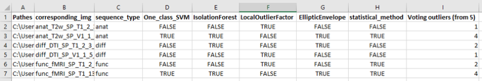

**Figure 8:** Exemplary snapshot of the voting.csv output results. Column A contains the direct path to the NIfTI file or the raw Bruker sequence. Column B is the name of a snapshot saved for quick inspection in the manual slice inspection folder. Column C refers to the sequence type. Columns E to H refer to the different outlier algorithms’ outputs, with TRUE indicating flagging the file as an outlier and FALSE indicating no outlier. Column I shows the sum of the votes from the outlier algorithms.

8b) Also available in the outputs of AIDAqc are, of course, the individual feature calculations in the calculated features folder, separated into multiple CSV files based on the sequence. In [Fig. 9](#figure-9), you can see a stitched example of all three available sequence types. For each sequence, there is a column similar to the voting.csv containing the corresponding path to the image file, the sequence type (which should be the same for each CSV file), resolution information in the x, y, and z coordinates of the image, and the corresponding features for each sequence.

<a id="figure-9"></a>

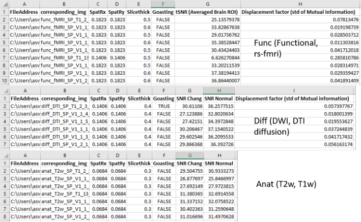

**Figure 9:** Exemplary snapshot of the calculated features folder in the output results of AIDAqc.

8c) Lastly, as mentioned before, a folder is created called manual slice inspection, which contains snapshots of all the subjects parsed by using the pipeline on the corresponding project. This is solely for the purpose of quick screening of the data by the user. As these snapshots are produced live while the pipeline is running, it can also be very useful to see if the desired images are processed and not some other post-processed files. If this is not the case, the user can stop the process and adjust any necessary exclusions or suffix requirements when using ParsingData.py.

<a id="figure-10"></a>

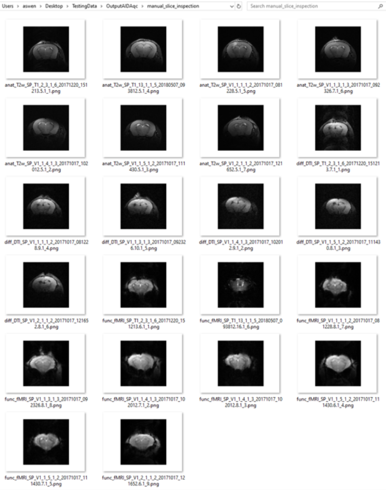

**Figure 10:** Exemplary snapshot of the manual slice inspection folder in the output results of AIDAqc.

<a id="faq"></a>

## FAQ

### Q1) How is the SNR of the T2w and DTI sequences calculated?

The SNR is calculated based on two methods, first one is based on [chang method](https://www.spiedigitallibrary.org/conference-proceedings-of-spie/5747/0000/An-automatic-method-for-estimating-noise-induced-signal-variance-in/10.1117/12.596008.short?SSO=1). Simply said this method calculated the SNR without needing to define regions in the image. The second one uses the standard way of calculating SNR namely defining regions of interest inside and outside of the brain. As for this pipeline, the input T2w dataset usually consists of more the one slice of the brain. For example, we have an image set with a dimension of 128 × 128 × 20, the pipeline extracts the 5 best subsequent slices with the highest average value indicating a good image of the brain. Usually, the best slices are the middle ones. If the first or the last slices are the highest slices a warning like in figure [11](#figure-11) will be shown in the terminal and this can indicate a faulty dataset. The reason for this happening can be two things, either the dataset has just one slice which makes no problem and the error can be ignored or the dataset has more slices and it was a faulty measurement where the position of the slice was selected wrongly.

<a id="figure-11"></a>

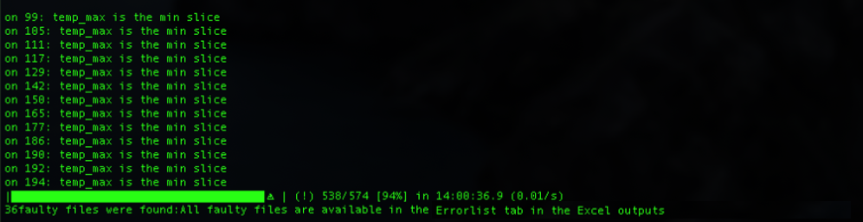

**Figure 11:** Warning for a dataset in which the first or the last slices have the most signal.

### Q2) How is the tSNR calculated?

To calculate the temporal signal-to-noise ratio multiple approaches are available in the literature, most of them are using normal SNR measurements but add some calculation steps to make it legitimate to be called tSNR. Let’s assume a simple example again to understand how it is calculated in this pipeline. Consider an fMRI dataset with dimensions of 128 × 128 × 20 × 500 with 20 being the slices and 500 being the temporal time points. Similar to the T2w approach, the 4 best subsequent slices are chosen based on average image intensity. After this step, SNR is calculated based on this [tSNR method](https://www.sciencedirect.com/science/article/pii/S105381190600992X). Simply said the tSNR is calculated for each voxel over time, and then it is averaged for a region in the brain. Note that this region definition is all happening automatically based on an automatic threshold and an automatic identification of the center of mass of the image.

$$
\mathrm{tSNR} = \frac{\mu}{\sigma} = \frac{\mu}{\sqrt{\frac{1}{N}\sum_{i=1}^{N}(x_i-\mu)^2}}
$$

This is done for all voxels of the defined volume, grown from the center of mass. The final tSNR is the average value of those.

### Q3) How is the Movement severity calculated?

Mutual information (MI) was used to calculate the movement severity in the resting state MR measurements. Check out [Mutual information as an image matching metric](https://matthew-brett.github.io/teaching/mutual_information.html) to better understand the concept of Mutual information in image analysis. To explain how MI was used in this pipeline, it’s easier to use our example dataset with a dimension of 128 × 128 × 20 × 500. The question is how much movement has happened between the image at T = t and T = t + 1. The four best slices are chosen based on the approach already explained in Q1 and Q2. The image of the first time point is then used as the reference image and all of the following 499 images are compared to the first one by calculating the MI between them. If the MI is high, it means the movement was small. If it’s low then the movement was relatively big. The standard deviation of all the MI values is then used as a metric for the overall movement severity. So the final output observable in the CSV file are standard deviation values.

### Q4) How does the parsing work in detail?

The parsing technique of this pipeline can be difficult to understand. With the help of figure [12](#figure-12) it gets clearer how the parsing works.

<a id="figure-12"></a>

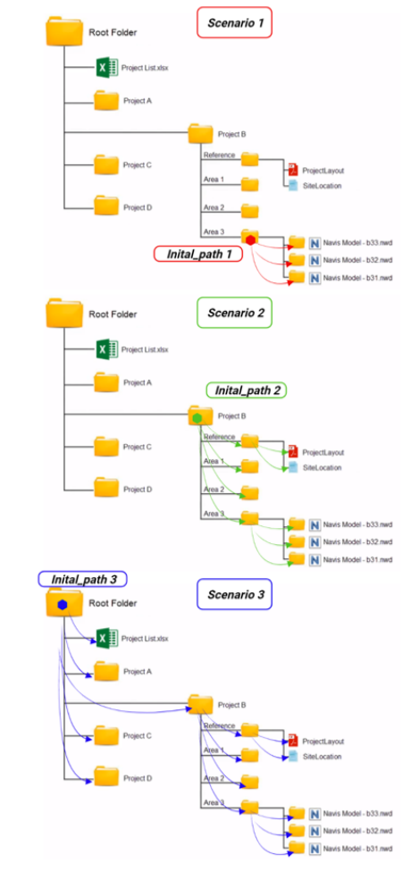

**Figure 12:** In this illustration, three scenarios can be seen. In each scenario the initial path as used in figure [6](#figure-6) is set to different folders. The colored arrows are the exact way how the pipeline searches the folders for MR files.

### Q5) Can the pipeline process other sequences as well?

For now, the pipeline can only parse T2w, DTI, and fMRI sequences. This is done by using the sequence types extracted from the header information of each measurement. In this pipeline, they are defined as: `['Dti*', 'EPI', 'RARE']` which are only related to the sequence type used for the measurement and the names are predefined default names of Bruker’s ParaVision Software. So it might be possible that other kinds of measurements use these sequences as well but are not compatible to be used with this pipeline[^1]. Another problem that might accrue is that if one of the permitted sequences (T2w, DTI, fMRI) is measured with multiple echo times, repetition times, separate receiver channels, repetitions for averaging purposes, or any kind of additional dimension except Slices, Time and Diffusion directions, the pipeline will not work. It is planned for the near future to add more features.

### Q6) How are the SNR of the T2w and DTI sequences calculated?

The only difference that we have in the DTI scans compared to the T2w scans, is the dimension of the diffusion directions. Here a small portion of the images in the diffusion direction is used to calculate the SNR similar to the T2w approach.

### Q7) Why is the pipeline divided into separate stages?

The reason behind this is to increase the stability of the program and to prevent the need to run the pipeline multiple times from the beginning. As explained above, separate CSV tables are created in each stage. Stage (I) is relatively fast and it won’t cause any long waiting periods to rerun that part if necessary. Stage(II) on the other hand can take more time, sometimes up to hours to finish, therefore it is possible that if an error accrues in the plotting part of the code, to simply correct the error and read the CSV file created from the second stage and to do the plotting without the need to wait again for the whole pipeline to run again from the beginning.

### Q9) What is meant by the warning: Some faulty files were found: All faulty files are available in the Errorlist?

With this warning, the pipeline just informs the user that some key files of the main image file could not be read. These can be one of the method, viso parameters, ... files from the Bruker sequence folder. However, all these files are also listed and saved in a separate csv file in the output folder.

### Q9) After running the pipeline, where can I find the data which should be excluded?

In the final CSV sheet named voting.csv are all of the data listed which had at least one vote from the machine-learning outlier detectors (”Judges”). If all five outlier detectors have voted the Image as an outlier, it can be said with a high possibility that it is really bad. And usually based on experience the images with all five detectors voting for a bad/outlier image are pure noise images or extreme Ghosting artifacts.

### Q10) When running the help option of the function ParsingData.py, there are other options as well, can you elaborate more about them?

The -i and -o are self-explanatory. -f can be used if it should check raw Bruker data or Nifti data. Be aware that the tool is more stable for only Nifti data. The reading process of raw data can vary a lot between datasets and is not guaranteed to function for any kind of raw dataset. -s is a useful flag and it will be only used for processing Nifti data. Imagine you have your main T2.nii.gz file which you want to process with this tool. Also because of some other processing you already have done, there are lots of irrelevant nii files available that you don’t want to include in the quality assessment for example T2.mask.nii, T2.proccesed.nii, T2Mask.seperated.nii, etc. It might even be the reason for ”the error” while using the tool. By using the -s flag you can set it as -s T2, and the tool will only look/parse for files ending with `*T2.nii`.

## Author

I have designed this pipeline to help me validate all the MR data that I use for further processing in my project. I was searching for a kind of standardization to dichotomize MR data into good and bad data. Over time I found out that this can’t be done as easily as thought. The key point of this standardization tool is that one realizes good and bad can not be set with fixed global values of any kind of features like the SNR and as everything in life is, it should be looked at relatively.

## Contact

Please report bugs and technical issues directly in [GitHub Issues](https://github.com/Aswendt-Lab/AIDAqc/issues).

For all other requests, email [aswendtlab@gmail.com](mailto:aswendtlab@gmail.com).

The end

<a id="sequence-note"></a>

[^1]: For example Arterial Spin Labeling (ASL) sequences, DCE and DSC sequences, etc.
